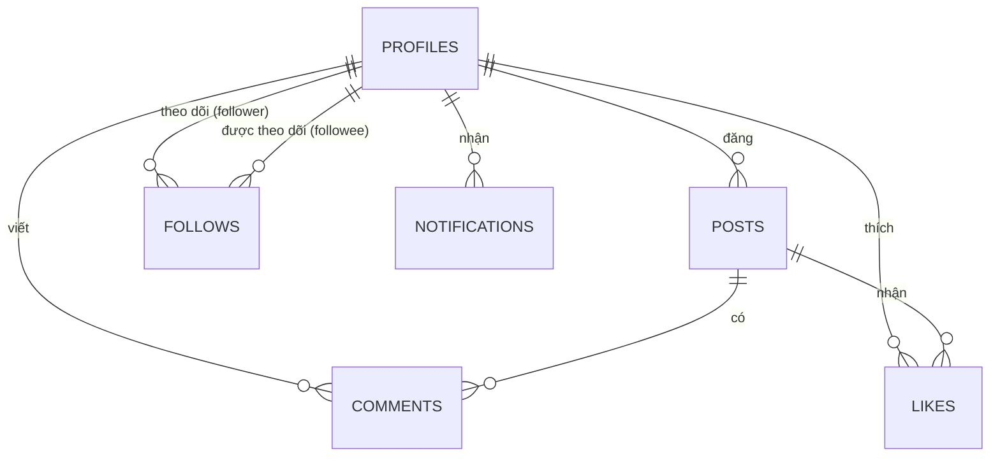
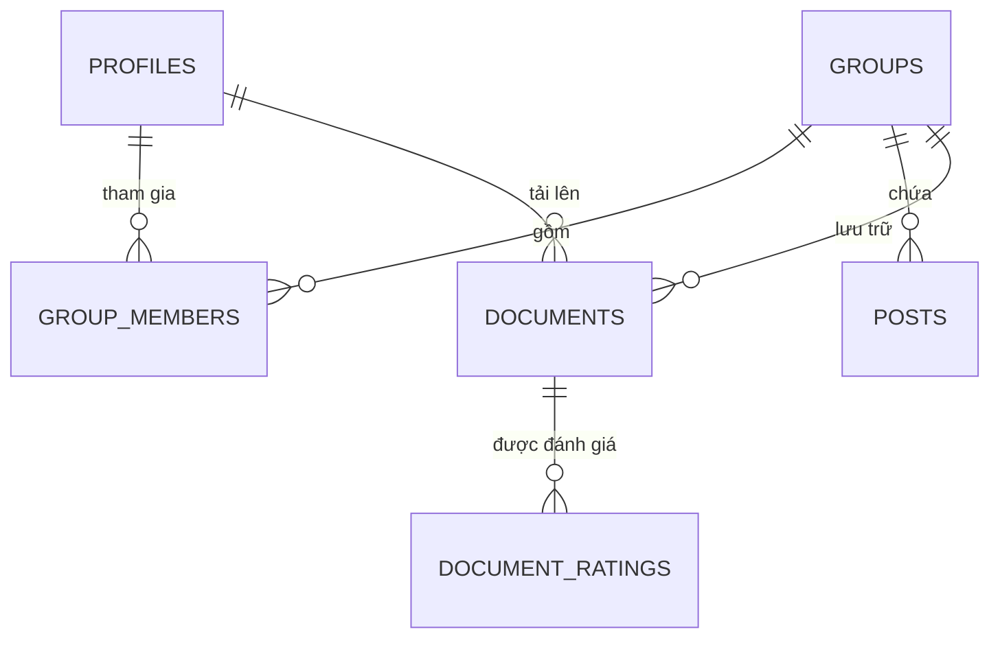
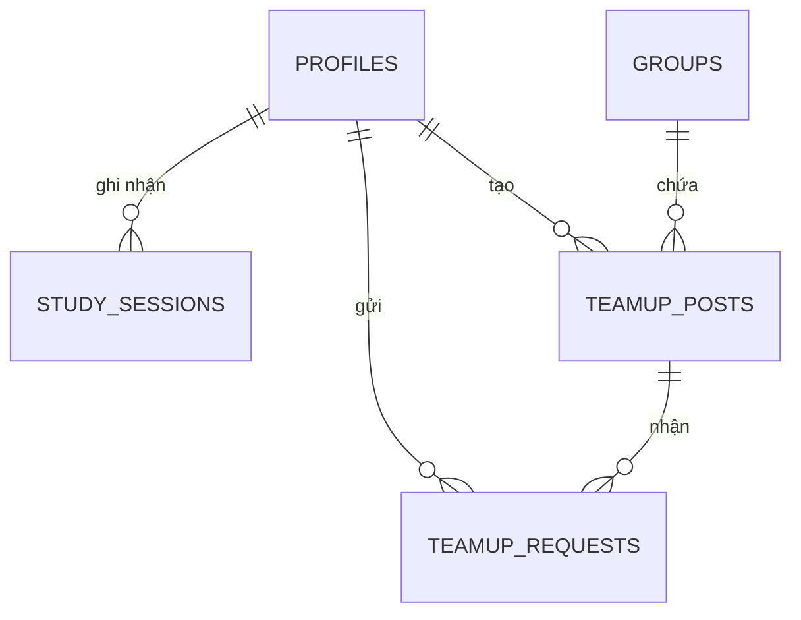
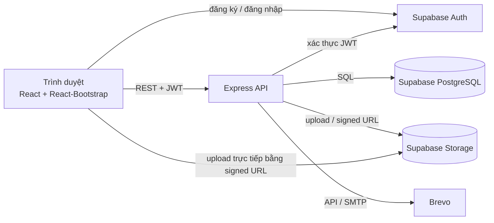

# ĐẶC TẢ YÊU CẦU PHẦN MỀM (SRS)

**Đề tài:** Xây dựng website mạng xã hội dành cho sinh viên đại học – UniSync
**Môn học:** Công nghệ Web và ứng dụng (SE347)
**Nhóm:** 5 thành viên
**Thời gian thực hiện:** 11/2026 – 12/2026
**Phiên bản:** 0.3 (đã chốt tên miền doqin.io.vn, hạn mức Brevo, giới hạn Vercel)

> Quy ước độ ưu tiên: **M** = Must (bắt buộc), **S** = Should (nên có nếu đủ thời gian), **O** = Optional (tùy chọn, làm sau cùng).
> Các mục đánh dấu **[GĐ]** là giả định do người soạn đưa ra, nhóm cần xác nhận hoặc sửa.

---

## 1. Giới thiệu

### 1.1 Mục đích
Tài liệu mô tả yêu cầu của website mạng xã hội cho sinh viên Việt Nam. Ngoài các chức năng mạng xã hội cơ bản, hệ thống có ba tính năng chuyên biệt: **Thư viện tài liệu**, **Góc học tập (Pomodoro)** và **Bảng tìm đồng đội (Team-up)**. Tài liệu là cơ sở cho Chương 1 (giới thiệu, chức năng, sitemap) và Chương 3 (phân tích thiết kế) của báo cáo đồ án.

### 1.2 Phạm vi
- Ứng dụng web responsive, chạy trên trình duyệt máy tính và điện thoại.
- Chỉ dành cho sinh viên có email trường kết thúc bằng **`.edu.vn`**.
- Gồm frontend (SPA) và backend (REST API) riêng biệt.

**Ngoài phạm vi (v1):** ứng dụng di động native, thông báo đẩy (push), gọi video, thanh toán, thuật toán xếp hạng bảng tin.

### 1.3 Đối tượng sử dụng tài liệu
Thành viên nhóm (phát triển, kiểm thử), giảng viên (đánh giá).

### 1.4 Thuật ngữ

| Thuật ngữ | Ý nghĩa |
|---|---|
| Nhóm học phần (Course group) | Nhóm được tạo sẵn cho một môn học hoặc một lớp học phần |
| Nhóm ngành (Major group) | Nhóm được tạo sẵn cho một ngành học |
| Mutual | Hai người dùng theo dõi lẫn nhau (kiểu Twitter) |
| Team-up | Bài đăng tìm đồng đội làm bài nhóm/đồ án, gắn với một nhóm học phần |
| Pomodoro | Kỹ thuật học theo chu kỳ tập trung (mặc định 25 phút) và nghỉ (5 phút) |
| Streak | Số ngày liên tiếp có ít nhất một phiên tập trung hoàn thành |

---

## 2. Mô tả tổng quan

### 2.1 Tác nhân (Actor)

| Tác nhân | Mô tả |
|---|---|
| Khách (Guest) | Chưa đăng nhập; chỉ xem trang giới thiệu, đăng ký, đăng nhập |
| Sinh viên | Đã xác minh email `.edu.vn`; dùng toàn bộ chức năng |
| Quản lý nhóm | Sinh viên được gán quyền duyệt thành viên của một nhóm **[GĐ]** |
| Quản trị viên (Admin) | Tạo sẵn nhóm, gán quản lý nhóm, gỡ nội dung vi phạm |
| Điều hành viên (Moderator) | **O** – xử lý báo cáo vi phạm; nếu không làm thì Admin kiêm nhiệm |

### 2.2 Môi trường và công nghệ

| Thành phần | Lựa chọn |
|---|---|
| Frontend | Vite + React, **React-Bootstrap** (Bootstrap 5), React Router |
| Thư viện bổ sung | Chart.js (biểu đồ thống kê học tập), AOS hoặc AnimeJS (hiệu ứng, tùy chọn) |
| Backend | Node.js + Express (REST API) |
| Cơ sở dữ liệu | Supabase PostgreSQL |
| Xác thực | Supabase Auth (email + mật khẩu, xác minh email); Express xác thực JWT |
| Lưu trữ tệp | Supabase Storage |
| Gửi email | **Brevo** (SMTP cho Supabase Auth; API/SMTP cho email thông báo team-up) |
| Triển khai | **Vercel**: frontend Vite (tĩnh) và backend Express (Vercel Functions) |

### 2.3 Ràng buộc
- Bắt buộc dùng framework Bootstrap; có cả frontend và backend.
- Hạn chót: cuối tháng 12/2026, chưa có ngày chính thức.
- Dùng gói **Supabase Free** (xem mục 8).
- Báo cáo theo mẫu chung của khoa; website cần có **từ 10 trang trở lên** (xem mục 7).

### 2.4 Giả định
1. **[GĐ]** Một trường/một hệ thống chung; mọi email `.edu.vn` đều hợp lệ, không phân tách dữ liệu theo trường.
2. **[GĐ]** Nội dung bài đăng và hồ sơ hiển thị cho mọi sinh viên đã đăng nhập; bài đăng trong nhóm chỉ thành viên đã được duyệt mới thấy.
3. **[GĐ]** Thư viện tài liệu xem và tải được bởi mọi sinh viên đã đăng nhập; chỉ thành viên đã được duyệt của nhóm học phần mới được tải lên tài liệu cho môn đó.
4. **[GĐ]** Nhóm và danh sách môn học do Admin nhập sẵn (seed) bằng script, không có giao diện tạo nhóm cho sinh viên.
5. **[GĐ]** Việc duyệt thành viên nhóm do Quản lý nhóm hoặc Admin thực hiện.

---

## 3. Yêu cầu chức năng

### 3.1 Tài khoản và xác thực

| ID | Yêu cầu | Ưu tiên |
|---|---|---|
| FR-AUTH-01 | Đăng ký bằng email, mật khẩu, họ tên. Email phải khớp mẫu `@*.edu.vn`; kiểm tra ở cả frontend và backend | M |
| FR-AUTH-02 | Gửi email xác minh; tài khoản chưa xác minh không đăng nhập được | M |
| FR-AUTH-03 | Đăng nhập, đăng xuất, duy trì phiên bằng JWT | M |
| FR-AUTH-04 | Quên mật khẩu / đặt lại mật khẩu qua email | S |
| FR-AUTH-05 | Đổi mật khẩu khi đã đăng nhập | S |
| FR-AUTH-06 | Phân quyền: sinh viên, quản lý nhóm, admin | M |

### 3.2 Hồ sơ cá nhân

| ID | Yêu cầu | Ưu tiên |
|---|---|---|
| FR-PRO-01 | Xem hồ sơ: ảnh đại diện, tên, ngành, trường, năm học, giới thiệu, số người theo dõi/đang theo dõi | M |
| FR-PRO-02 | Chỉnh sửa hồ sơ, tải ảnh đại diện | M |
| FR-PRO-03 | Trang hồ sơ liệt kê bài đăng của người đó | M |
| FR-PRO-04 | Hiển thị nhóm đã tham gia và thống kê học tập công khai (streak) | S |

### 3.3 Mạng xã hội cốt lõi

| ID | Yêu cầu | Ưu tiên |
|---|---|---|
| FR-SOC-01 | Tạo, sửa, xóa bài đăng (văn bản, tối đa 1–4 ảnh) | M |
| FR-SOC-02 | Bảng tin trang chủ: bài của người mình theo dõi và của chính mình, **sắp xếp theo thời gian mới nhất**, phân trang/tải thêm | M |
| FR-SOC-03 | Bình luận bài đăng; xóa bình luận của mình | M |
| FR-SOC-04 | Thích / bỏ thích bài đăng; hiển thị số lượt thích | M |
| FR-SOC-05 | Theo dõi / bỏ theo dõi người dùng (một chiều). Hai người theo dõi nhau được gắn nhãn **Mutual** | M |
| FR-SOC-06 | Trang gợi ý/tìm người dùng theo tên | S |
| FR-SOC-07 | Thông báo trong ứng dụng: có người theo dõi, thích, bình luận, duyệt nhóm, yêu cầu tham gia team-up | S |
| FR-SOC-08 | Báo cáo bài đăng/bình luận vi phạm | O |
| FR-SOC-09 | Nhắn tin trực tiếp giữa các Mutual (dùng Supabase Realtime) | O |

### 3.4 Nhóm học phần và nhóm ngành

| ID | Yêu cầu | Ưu tiên |
|---|---|---|
| FR-GRP-01 | Danh sách nhóm (lọc theo loại: học phần / ngành), tìm kiếm nhóm | M |
| FR-GRP-02 | Gửi yêu cầu tham gia nhóm; trạng thái: chờ duyệt / đã duyệt / từ chối | M |
| FR-GRP-03 | Quản lý nhóm / Admin xem danh sách chờ duyệt, duyệt hoặc từ chối | M |
| FR-GRP-04 | Trang nhóm gồm các tab: Bảng tin nhóm, Thư viện tài liệu, Team-up, Thành viên | M |
| FR-GRP-05 | Thành viên đã duyệt đăng bài trong nhóm; chỉ thành viên đã duyệt xem được | M |
| FR-GRP-06 | Rời nhóm | S |
| FR-GRP-07 | Admin tạo sẵn nhóm bằng script seed (danh sách ngành, môn học) | M |

### 3.5 Thư viện tài liệu

| ID | Yêu cầu | Ưu tiên |
|---|---|---|
| FR-DOC-01 | Tải lên tài liệu cho một môn học: tiêu đề, mô tả, môn học, tệp | M |
| FR-DOC-02 | Chỉ nhận **PDF, DOCX, PPTX, PNG, JPG, WEBP**; tối đa **10 MB/tệp**; kiểm tra phần mở rộng, MIME type ở backend và hạn chế trên bucket | M |
| FR-DOC-03 | Tài liệu được tổ chức theo môn học; duyệt danh sách theo môn | M |
| FR-DOC-04 | **Tìm kiếm** theo tiêu đề, mô tả, tên môn (Postgres full-text, hỗ trợ không dấu tiếng Việt); lọc theo môn, loại tệp | M |
| FR-DOC-05 | Tải xuống tài liệu (dùng signed URL có thời hạn ngắn) | M |
| FR-DOC-06 | Người tải lên sửa thông tin/xóa tài liệu của mình; Admin xóa tài liệu vi phạm | M |
| FR-DOC-07 | Đếm lượt tải xuống | O |
| FR-DOC-08 | Đánh giá tài liệu 1–5 sao; hiển thị điểm trung bình, sắp xếp theo điểm | O |
| FR-DOC-09 | Xem trước PDF ngay trên trang | O |
| FR-DOC-10 | Báo cáo tài liệu vi phạm bản quyền | O |

**Luồng tải lên tài liệu (do giới hạn của Vercel, xem mục 6.1):**
1. Client gửi tiêu đề, mô tả, nhóm học phần, tên, loại và kích thước tệp tới Express.
2. Express kiểm tra JWT, tư cách thành viên đã duyệt, phần mở rộng/MIME và kích thước ≤ 10 MB, rồi trả về signed upload URL.
3. Client tải tệp thẳng lên Supabase Storage.
4. Client báo hoàn tất; Express kiểm tra tệp đã tồn tại (loại, kích thước thực) rồi ghi bản ghi vào `documents`; nếu không hợp lệ thì xóa tệp.

### 3.6 Góc học tập (Pomodoro)

| ID | Yêu cầu | Ưu tiên |
|---|---|---|
| FR-STU-01 | Đồng hồ Pomodoro chạy phía client: bắt đầu, tạm dừng, đặt lại, tự chuyển giữa tập trung / nghỉ ngắn / nghỉ dài | M |
| FR-STU-02 | Tùy chỉnh thời lượng (mặc định 25/5/15 phút, nghỉ dài sau 4 chu kỳ); lưu cài đặt vào hồ sơ | M |
| FR-STU-03 | Đồng hồ vẫn chính xác khi chuyển tab (tính theo mốc thời gian thực, không đếm bằng `setInterval` thuần) | M |
| FR-STU-04 | Khi hoàn thành một phiên tập trung, gửi lên server để lưu (thời lượng, thời điểm, nhãn/môn học tùy chọn) | M |
| FR-STU-05 | Thống kê: tổng thời gian tập trung hôm nay/tuần/tháng, số phiên, **streak** hiện tại và dài nhất | M |
| FR-STU-06 | Biểu đồ thời gian học theo ngày trong 7/30 ngày gần nhất (Chart.js) | S |
| FR-STU-07 | Âm báo khi hết phiên; thông báo trình duyệt (Notification API) | S |
| FR-STU-08 | Mục tiêu học mỗi ngày (số phút) và tiến độ | O |
| FR-STU-09 | Bảng xếp hạng thời gian học giữa các thành viên cùng nhóm | O |

**Quy tắc streak:** một ngày được tính khi có ít nhất một phiên tập trung hoàn thành; ngày tính theo múi giờ **Asia/Ho_Chi_Minh (UTC+7)**; bỏ lỡ một ngày thì streak về 0.

### 3.7 Bảng tìm đồng đội (Team-up)

| ID | Yêu cầu | Ưu tiên |
|---|---|---|
| FR-TEAM-01 | Thành viên nhóm học phần đăng bài team-up: tiêu đề, mô tả, các vai trò cần tìm, số chỗ trống, hạn đăng ký | M |
| FR-TEAM-02 | Danh sách team-up theo nhóm; lọc theo trạng thái (đang mở / đã đủ / đã đóng), tìm kiếm | M |
| FR-TEAM-03 | Người khác gửi **yêu cầu tham gia** kèm lời nhắn ngắn | M |
| FR-TEAM-04 | Chủ bài xem danh sách yêu cầu, **chấp nhận hoặc từ chối** | M |
| FR-TEAM-05 | Khi số người được chấp nhận đủ số chỗ, bài tự chuyển sang "Đã đủ"; quá hạn thì "Đã đóng" | M |
| FR-TEAM-06 | Người gửi yêu cầu có thể hủy yêu cầu đang chờ | S |
| FR-TEAM-07 | **Email thông báo**: gửi cho chủ bài khi có yêu cầu mới; gửi cho người xin khi được chấp nhận/từ chối | S |
| FR-TEAM-08 | Thông báo trong ứng dụng cho các sự kiện trên (dự phòng nếu email chưa kịp làm) | S |
| FR-TEAM-09 | Chủ bài sửa, đóng hoặc xóa bài | M |

### 3.8 Quản trị

| ID | Yêu cầu | Ưu tiên |
|---|---|---|
| FR-ADM-01 | Trang quản trị: danh sách người dùng, nhóm, tài liệu, bài đăng | S |
| FR-ADM-02 | Khóa tài khoản; gỡ bài đăng/tài liệu/bình luận vi phạm | S |
| FR-ADM-03 | Gán/gỡ quyền Quản lý nhóm | S |
| FR-ADM-04 | Vai trò Moderator và hàng đợi xử lý báo cáo | O |

---

## 4. Yêu cầu phi chức năng

| ID | Nhóm | Yêu cầu |
|---|---|---|
| NFR-01 | Giao diện | Responsive, hiển thị tốt từ 360 px đến desktop; dùng lưới Bootstrap |
| NFR-02 | Hiệu năng | Trang chính tải dưới 3 giây trên mạng thường; API thường trả lời dưới 500 ms; chịu được khoảng 100 người dùng đồng thời (đủ cho demo) |
| NFR-03 | Bảo mật | Mật khẩu được Supabase Auth băm; mọi API ngoài đăng ký/đăng nhập đều yêu cầu JWT hợp lệ; kiểm tra quyền ở backend |
| NFR-04 | Bảo mật | Bật **Row Level Security** trên các bảng; khóa secret (`sb_secret_…`, trước đây `service_role`) chỉ nằm ở backend, không bao giờ đưa vào frontend |
| NFR-05 | Bảo mật | Kiểm tra và làm sạch dữ liệu đầu vào (schema validation, ví dụ zod); chống XSS (React escape mặc định, không dùng `dangerouslySetInnerHTML`); cấu hình CORS giới hạn; rate limit cho đăng nhập/đăng ký/tải lên |
| NFR-06 | Tệp | Kiểm tra loại và kích thước tệp; đặt tên tệp lưu trữ bằng UUID; bucket không công khai, tải xuống qua signed URL |
| NFR-07 | Khả dụng | Giao diện tiếng Việt; có trạng thái đang tải, lỗi, danh sách trống |
| NFR-08 | Trợ năng | Thẻ ngữ nghĩa, có `alt` cho ảnh, tương phản màu đạt WCAG AA, thao tác được bằng bàn phím |
| NFR-09 | Tương thích | Chrome, Edge, Firefox, Safari phiên bản mới nhất (2 bản gần nhất) |
| NFR-10 | Bảo trì | Mã nguồn quản lý bằng Git, tách `frontend/` và `backend/`, cấu hình qua biến môi trường, có README hướng dẫn cài đặt |
| NFR-11 | Triển khai | Có bản chạy trực tuyến trên **Vercel** để demo; tự động triển khai khi đẩy code lên nhánh chính; biến môi trường cấu hình trên Vercel (xem mục 6.1) |

---

## 5. Mô hình dữ liệu

### 5.1 Sơ đồ ER

Để dễ đọc, sơ đồ ER được tách thành ba phần; thực thể `PROFILES` xuất hiện ở cả ba phần.

**a) Mạng xã hội cốt lõi**

**b) Nhóm và thư viện tài liệu**

**c) Góc học tập và team-up**

`DOCUMENT_RATINGS` là thực thể tùy chọn (O).

### 5.2 Các bảng chính

| Bảng | Trường chính |
|---|---|
| `profiles` | id (= auth.users.id), full_name, avatar_url, bio, major, school, year, role (`student`/`admin`/`moderator`), pomodoro_settings (jsonb), created_at |
| `groups` | id, type (`course`/`major`), name, code, description, created_at |
| `group_members` | group_id, user_id, status (`pending`/`approved`/`rejected`), role (`member`/`manager`), joined_at |
| `posts` | id, author_id, group_id (null = bài cá nhân), content, image_urls, created_at |
| `comments` | id, post_id, author_id, content, created_at |
| `likes` | post_id, user_id, created_at (khóa chính kép) |
| `follows` | follower_id, followee_id, created_at (khóa chính kép; Mutual = tồn tại cả hai chiều) |
| `documents` | id, group_id (nhóm học phần), uploader_id, title, description, file_path, file_type, file_size, download_count (O), created_at |
| `document_ratings` | document_id, user_id, stars (O) |
| `study_sessions` | id, user_id, started_at, duration_minutes, label, created_at |
| `teamup_posts` | id, group_id, author_id, title, description, roles_needed, slots, deadline, status (`open`/`filled`/`closed`) |
| `teamup_requests` | id, teamup_id, user_id, message, status (`pending`/`accepted`/`declined`/`cancelled`), created_at |
| `notifications` | id, user_id, type, payload (jsonb), is_read, created_at |

Chỉ mục gợi ý: `posts(created_at desc)`, `posts(group_id, created_at desc)`, GIN full-text trên `documents(title, description)`, `follows(followee_id)`.

---

## 6. Kiến trúc hệ thống

- Frontend gọi Supabase Auth trực tiếp cho đăng ký/đăng nhập; mọi dữ liệu nghiệp vụ đi qua Express.
- Express kiểm tra JWT, quyền hạn, ràng buộc nghiệp vụ (domain `.edu.vn`, loại tệp, trạng thái thành viên nhóm) rồi truy vấn cơ sở dữ liệu.
- Việc kiểm tra domain `.edu.vn` cần được ép ở phía server (không chỉ ở form), ví dụ qua một endpoint đăng ký của Express hoặc hook/trigger trong Supabase.

### 6.1 Triển khai trên Vercel

- **Monorepo:** một repo Git `unisync` gồm `frontend/` (Vite, build tĩnh), `backend/` (Express) và `docs/` (SRS, báo cáo). Trên Vercel tạo **hai dự án** từ cùng một repo, mỗi dự án đặt *Root Directory* lần lượt là `frontend` và `backend`; mỗi dự án chỉ build lại khi thư mục của nó thay đổi.
- **Tên miền `doqin.io.vn`** (trưởng nhóm nắm quyền DNS): đề xuất `unisync.doqin.io.vn` cho frontend và `api.unisync.doqin.io.vn` cho backend, gắn vào hai dự án Vercel (chứng chỉ HTTPS do Vercel cấp tự động; thêm các bản ghi CNAME/A mà Vercel yêu cầu). `FRONTEND_URL` dùng cho CORS phải trỏ đúng địa chỉ frontend. Địa chỉ gửi thư `noreply@doqin.io.vn`; xác thực tên miền `doqin.io.vn` trên Brevo bằng các bản ghi DNS SPF, DKIM và DMARC để thư xác minh ít bị đưa vào thư rác. Tên miền con cụ thể là đề xuất, có thể đổi nếu `doqin.io.vn` còn dùng cho dự án khác.
- **Frontend:** thêm rewrite về `index.html` để React Router hoạt động khi tải lại trang con.
- **Backend:** Express xuất `app` và chạy như Vercel Function (`api/index.js` + `vercel.json` chuyển mọi đường dẫn vào đó). Hàm không có trạng thái: không lưu tệp trên đĩa, không dùng bộ nhớ trong tiến trình làm kho dữ liệu, không dùng tác vụ nền chạy lâu.
- **Giới hạn kích thước body của Vercel Functions là 4,5 MB:** không thể đẩy tệp 10 MB qua Express. Ảnh bài đăng và ảnh đại diện (đã nén phía client, ≤ 1 MB mỗi ảnh) cũng dùng cùng luồng tải thẳng để không phụ thuộc vào giới hạn này. Vì vậy **luồng tải lên tài liệu** thiết kế như sau (xem mục 3.5): client gửi metadata → Express kiểm tra quyền, loại và kích thước tệp rồi cấp **signed upload URL** → client tải thẳng lên Supabase Storage → client gọi Express xác nhận để ghi bản ghi tài liệu.
- **Email:** gửi bằng Brevo trong cùng request (chờ phản hồi trước khi trả kết quả) vì hàm có thể bị dừng ngay sau khi trả lời.
- **Biến môi trường** đặt trên Vercel: `SUPABASE_URL`, `SUPABASE_PUBLISHABLE_KEY`, `SUPABASE_SECRET_KEY` (chỉ backend), `BREVO_API_KEY`, `FRONTEND_URL` (cho CORS). Không đưa vào repo.
- **Chống Supabase tạm dừng:** dùng **Vercel Cron** gọi một endpoint nhẹ (`/api/health`, có truy vấn CSDL) mỗi ngày.

---

## 7. Danh sách trang (sitemap)

Yêu cầu của đồ án là từ 10 trang trở lên; thiết kế hiện có khoảng 18 trang:

| # | Trang | Đường dẫn |
|---|---|---|
| 1 | Trang giới thiệu (Landing) | `/` |
| 2 | Đăng ký | `/register` |
| 3 | Đăng nhập | `/login` |
| 4 | Xác minh email / quên mật khẩu | `/verify`, `/reset-password` |
| 5 | Trang chủ – bảng tin | `/home` |
| 6 | Hồ sơ cá nhân | `/u/:id` |
| 7 | Chỉnh sửa hồ sơ & cài đặt | `/settings` |
| 8 | Chi tiết bài đăng | `/posts/:id` |
| 9 | Danh sách nhóm | `/groups` |
| 10 | Chi tiết nhóm (tab bảng tin / tài liệu / team-up / thành viên) | `/groups/:id` |
| 11 | Quản lý yêu cầu vào nhóm | `/groups/:id/requests` |
| 12 | Thư viện tài liệu (tìm kiếm, lọc) | `/library` |
| 13 | Chi tiết / tải lên tài liệu | `/library/:id`, `/library/new` |
| 14 | Góc học tập – Pomodoro | `/study` |
| 15 | Thống kê học tập | `/study/stats` |
| 16 | Danh sách team-up | `/teamups` |
| 17 | Chi tiết team-up & quản lý yêu cầu | `/teamups/:id` |
| 18 | Thông báo | `/notifications` |
| 19 | Tìm kiếm người dùng | `/search` |
| 20 | Quản trị | `/admin` |
| – | Tin nhắn (O) | `/messages` |

---

## 8. Giới hạn tài nguyên (Supabase Free)

| Tài nguyên | Giới hạn | Quyết định |
|---|---|---|
| Lưu trữ tệp | 1 GB tổng | Giới hạn 10 MB/tệp ≈ 100 tài liệu đầy; ảnh bài đăng/ảnh đại diện nén phía client (≤ 1 MB) |
| Kích thước tệp tối đa | 50 MB (toàn cục) | Đặt giới hạn bucket thấp hơn: 10 MB |
| Băng thông (egress) | 5 GB/tháng | Đủ cho khoảng 500 lượt tải tệp 10 MB |
| CSDL | 500 MB | Đủ cho dữ liệu văn bản |
| Người dùng hoạt động | 50.000 MAU | Dư rất nhiều |
| Tạm dừng | Sau 1 tuần không hoạt động | Đặt lịch gọi API định kỳ; kiểm tra và bật lại dự án trước buổi báo cáo |
| Số dự án | 2 | Một dự án dev, một dự án demo |
| Email xác minh | Dịch vụ gửi mặc định của Supabase bị giới hạn rất thấp | Dùng Brevo SMTP; gói miễn phí giới hạn **300 email/ngày** cho toàn hệ thống (xác minh email, đặt lại mật khẩu, thông báo team-up) |

---

## 9. Rủi ro

| Rủi ro | Mức | Giảm thiểu |
|---|---|---|
| Phạm vi quá lớn so với ~6 tuần và 5 người | Cao | Làm theo thứ tự ưu tiên M → S → O; cắt từ dưới lên |
| Dự án Supabase bị tạm dừng đúng ngày báo cáo | Trung bình | Lịch ping, kiểm tra trước ngày báo cáo |
| Email xác minh không gửi được hoặc rơi vào thư rác của hộp thư trường | Trung bình | Xác thực tên miền riêng trên Brevo (SPF, DKIM, DMARC) ngay tuần đầu; thử gửi tới địa chỉ `.edu.vn` thật; có tài khoản test được xác minh sẵn để demo |
| Vượt hạn mức 300 email/ngày của Brevo (ví dụ lớp đăng ký cùng lúc khi demo) | Trung bình | Chỉ gửi email cho xác minh, đặt lại mật khẩu và các sự kiện team-up (yêu cầu mới, kết quả); thông báo khác chỉ hiển thị trong ứng dụng; giới hạn số lần gửi lại email xác minh theo người dùng; ghi nhật ký số email đã gửi trong ngày; tạo sẵn tài khoản demo đã xác minh |
| Giới hạn body 4,5 MB của Vercel Functions chặn tải tệp lớn | Trung bình | Tải tệp thẳng lên Supabase Storage bằng signed URL (mục 6.1) |
| Hàm Vercel khởi động nguội làm API chậm ở lần gọi đầu | Thấp | Chấp nhận khi demo; có thể gọi trước một endpoint để làm nóng |
| Tải lên tệp độc hại hoặc vi phạm bản quyền | Trung bình | Kiểm tra loại tệp, Admin gỡ bài, điều khoản sử dụng; báo cáo vi phạm (O) |
| Phân quyền sai gây lộ dữ liệu nhóm | Trung bình | RLS + kiểm tra ở backend + test các trường hợp truy cập trái phép |
| Báo cáo đồ án theo mẫu thiên về thiết kế giao diện | Thấp | Chương 4 mô tả từng trang (giao diện, mô tả, kỹ thuật, code); chụp màn hình khi hoàn thành từng trang |

---

## 10. Kế hoạch giai đoạn (gợi ý)

| Giai đoạn | Thời gian | Nội dung |
|---|---|---|
| 1 | 17/11 – 23/11 | Dựng repo, khung frontend/backend, Supabase (schema, RLS, bucket), Auth + xác minh `.edu.vn`, thiết kế template Bootstrap chung |
| 2 | 24/11 – 30/11 | Hồ sơ, bài đăng, bình luận, thích, theo dõi, bảng tin |
| 3 | 01/12 – 07/12 | Nhóm (seed, xin vào, duyệt), thư viện tài liệu (tải lên, tìm kiếm, tải xuống) |
| 4 | 08/12 – 14/12 | Góc học tập (Pomodoro, thống kê, streak), team-up (đăng, xin vào, duyệt) |
| 5 | 15/12 – 20/12 | Email thông báo, thông báo trong ứng dụng, kiểm thử, sửa lỗi, triển khai |
| 6 | 20/12 – 31/12 | Viết báo cáo (docx), slide (pptx), tập thuyết trình; các mục **O** nếu còn thời gian |

Báo cáo nên viết song song (chụp ảnh từng trang ngay khi hoàn thành) thay vì dồn vào giai đoạn cuối.

---

## 11. Các quyết định đã chốt và điểm còn mở

**Đã chốt:**

| Nội dung | Quyết định |
|---|---|
| Tên sản phẩm | UniSync |
| Cấu trúc repo | Monorepo (`frontend/`, `backend/`, `docs/`), hai dự án Vercel |
| Giới hạn tệp tải lên | 10 MB/tệp |
| Tên miền | `doqin.io.vn`; trưởng nhóm (Khang) nắm quyền DNS; gắn vào Vercel và dùng làm tên miền người gửi trên Brevo |
| Email | Brevo, gói miễn phí 300 email/ngày |
| Giới hạn Vercel Functions | Body tối đa 4,5 MB; tải tệp và ảnh thẳng lên Supabase Storage bằng signed URL |
| Triển khai | Vercel |

**Còn mở:**

1. Tên miền con cho frontend và backend (đề xuất ở mục 6.1).
2. Các giả định đánh dấu **[GĐ]** ở mục 2.4.
3. Chủ các tài khoản Brevo, Vercel, Supabase và cách cấp quyền cho các thành viên còn lại.
4. Bảng phân công ở mục 12 (đổi nếu thành viên thấy chưa phù hợp với sở trường).

---

## 12. Phân công thành viên (đề xuất)

Nguyên tắc: mỗi người phụ trách trọn một module từ giao diện, API đến bảng dữ liệu và kiểm thử, để giảm xung đột mã nguồn và để mỗi người tự viết được phần báo cáo cho module của mình.

### 12.1 Danh sách nhóm

| STT | MSSV | Họ và tên | Vai trò |
|---|---|---|---|
| 1 | 24520763 | Nguyễn Tuấn Khang | Nhóm trưởng |
| 2 | 24520680 | Nguyễn Lê Đức Huy | Thành viên |
| 3 | 24520644 | Trần Hữu Quốc Hướng | Thành viên |
| 4 | 24521867 | Trần Đức Trọng | Thành viên |
| 5 | 24521865 | Nguyễn Minh Trọng | Thành viên |

### 12.2 Phân công theo module

| Thành viên | Module phụ trách | Yêu cầu liên quan | Trang liên quan |
|---|---|---|---|
| **Nguyễn Tuấn Khang** (nhóm trưởng) | Nền tảng và tài khoản: khung repo, thiết lập Supabase (schema, RLS, bucket), xác thực và kiểm tra `.edu.vn`, hồ sơ cá nhân, trang quản trị, triển khai, tích hợp nhánh code, cấu hình DNS `doqin.io.vn` và Brevo SMTP | FR-AUTH-01..06, FR-PRO-01..04, FR-ADM-01..04, FR-GRP-07 (script seed), NFR-03..06, NFR-10, NFR-11 | Đăng ký, đăng nhập, xác minh/đặt lại mật khẩu, hồ sơ, cài đặt, quản trị |
| **Nguyễn Lê Đức Huy** | Mạng xã hội cốt lõi: bài đăng, bình luận, thích, theo dõi (Mutual), bảng tin theo thời gian, thông báo trong ứng dụng | FR-SOC-01..09 | Trang chủ (bảng tin), chi tiết bài đăng, thông báo |
| **Trần Hữu Quốc Hướng** | Nhóm và Team-up: danh sách nhóm, xin vào và duyệt thành viên, bảng tin nhóm, bài team-up, yêu cầu tham gia, email thông báo | FR-GRP-01..06, FR-TEAM-01..09 | Danh sách nhóm, chi tiết nhóm, quản lý yêu cầu vào nhóm, danh sách và chi tiết team-up |
| **Trần Đức Trọng** | Thư viện tài liệu: tải lên, kiểm tra loại và kích thước tệp, tìm kiếm full-text, tải xuống bằng signed URL, đánh giá, đếm lượt tải | FR-DOC-01..10, NFR-06 (phần tệp) | Thư viện tài liệu, chi tiết và tải lên tài liệu |
| **Nguyễn Minh Trọng** | Giao diện chung và Góc học tập: template Bootstrap (navbar, footer, layout, theme), trang giới thiệu, tìm kiếm người dùng, Pomodoro, thống kê, streak, biểu đồ | FR-STU-01..09, FR-SOC-06, NFR-01, NFR-07, NFR-08 | Landing, tìm kiếm, Góc học tập, thống kê học tập |

**Lưu ý về thứ tự:**
- Khang và Minh Trọng cần hoàn thành khung repo, template giao diện và đăng nhập trong **giai đoạn 1** (đến 23/11) vì các module còn lại phụ thuộc vào đó. Trong lúc chờ, các bạn còn lại viết schema bảng và API cho module của mình bằng dữ liệu giả.
- Hướng phụ thuộc vào bảng `groups` do Khang seed; Đức Trọng phụ thuộc vào `groups` và `group_members` của Hướng. Nên thống nhất schema các bảng này ngay trong tuần đầu.

### 12.3 Phân công báo cáo và thuyết trình

| Phần | Người phụ trách |
|---|---|
| Chương 1: Giới thiệu, sitemap; Chương 5: Kết luận; tổng hợp, định dạng báo cáo | Nguyễn Tuấn Khang |
| Chương 2: Cơ sở lý thuyết (HTML/CSS/JS, Bootstrap, React) | Nguyễn Minh Trọng |
| Chương 2: Cơ sở lý thuyết (Node/Express, REST, Supabase, JWT) | Nguyễn Lê Đức Huy |
| Chương 3: Phân tích thiết kế (use case, ER, kiến trúc) từ SRS | Trần Hữu Quốc Hướng |
| Chương 4: Thiết kế template và các trang của module mình phụ trách | Mỗi người, theo bảng 12.2 |
| Slide thuyết trình, demo | Trần Đức Trọng (slide), cả nhóm (demo theo module) |

### 12.4 Bảng đánh giá mức độ hoàn thành

Mẫu báo cáo yêu cầu mỗi sinh viên có phần "Đánh giá mức độ hoàn thành: xx.xx%". Nhóm cập nhật cột này khi kết thúc đồ án.

| Thành viên | Công việc chính | Mức độ hoàn thành |
|---|---|---|
| Nguyễn Tuấn Khang | Nền tảng, xác thực, hồ sơ, quản trị, Vercel, Brevo | xx.xx% |
| Nguyễn Lê Đức Huy | Mạng xã hội cốt lõi | xx.xx% |
| Trần Hữu Quốc Hướng | Nhóm và Team-up | xx.xx% |
| Trần Đức Trọng | Thư viện tài liệu | xx.xx% |
| Nguyễn Minh Trọng | Giao diện chung, Góc học tập | xx.xx% |
